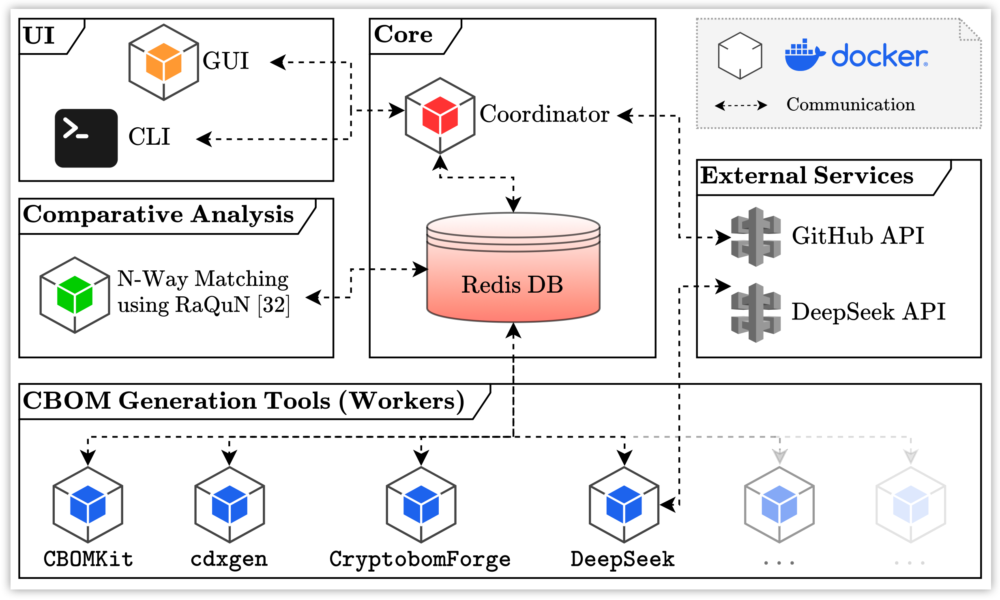

# **BF-CBOM**: Best Friend for Cryptography Bill of Materials

*A comprehension-centric framework for analyzing Cryptography Bill of Material (CBOMs) generated by various tools. Compare CBOM outputs side-by-side, explore detected cryptographic assets, and orchestrate end-to-end benchmarks across containerized generators. In essence, your **b**est **f**riend for understanding the cryptographic posture of your software.*

<div align="center">
  
  
</div>

</br>

<div align="center">
  <strong>
    👋 <a href="#introduction">Introduction</a> &nbsp;&nbsp;| &nbsp;&nbsp; 
    🚀 <a href="#setup">Setup</a> &nbsp;&nbsp;|&nbsp;&nbsp; 
    🛠️ <a href="#developer-notes">Developer Notes</a> 
  </strong>
</div>

</br>
.
<div align="center">
  <a href="https://github.com/SEG-UNIBE/BF-CBOM/releases"></a>
  <a href="https://youtu.be/-YdBPHsyymU"></a>
  <a href="https://doi.org/10.5281/zenodo.17140610"></a>
  </br>
  <a href="#"></a>
  <a href="#"></a>
  <a href="#"></a>
  <a href="./LICENSE"></a>
</div>

</br>
</br>

## Introduction

BF-CBOM helps you inspect the cryptographic footprint of your software by analyzing CBOMs generated by multiple tools.
Its primary focus is **comprehension** — exploring, comparing, and making sense of cryptographic assets detected across different generators in a unified analysis layer.
It also offers **benchmarking capabilities** to orchestrate batch CBOM generation and evaluate tool performance at scale.

### Key Features

- **Coordinator-first control plane:** a Streamlit UI backed by Redis schedules inspections, tracks job state, and surfaces results for reviewers.
- **Containerised worker plugins:** every CBOM generator runs in its own Docker image but speaks the same Redis-driven instruction protocol.
- **Scriptable CLI:** a Typer-based interface can launch inspections, export configs, or bundle CBOM artefacts for offline analysis.
- **Reproducible runs:** checked-in `.env` templates, Dockerfiles, and `uv`-managed Python dependencies keep environments consistent across machines.

**[▶️ Watch the Demo Video](https://youtu.be/-YdBPHsyymU)** - See BF-CBOM's features in action with a walkthrough of the UI, inspection process, and analysis capabilities.

### CBOM Generators Under Scrutiny

BF-CBOM integrates 15 CBOM generator tools for side-by-side comparisons.
Each generator brings a unique methodology for detecting and cataloging cryptographic assets:

- **[`CBOMKit`](https://github.com/PQCA/cbomkit)**:
IBM Research's dedicated CBOM generator for Java, Python and Go, now maintained by the Post-Quantum Cryptography Alliance.
Uses SonarQube for static analysis and supports compliance policy checks.

- **`CBOMKit` action jar** ([cbomkit-action](https://github.com/cbomkit/cbomkit-action)):
the same sonar-cryptography engine packaged as a standalone jar, run without the server and database and with the languages (Java, Python, Go) chosen per repository. Kept as a second worker so differences between the two packagings are measured; in agreement-based scoring both count as one voter (`voter_group` in `common/tools.yaml`).

- **[`cdxgen`](https://github.com/CycloneDX/cdxgen)**:
CycloneDX's official generator, primarily for SBOMs but with CBOM extensions since April 2024. Its crypto output is mostly crypto libraries and key/certificate files; algorithms come with file and line only for JavaScript/TypeScript and Go. For Python and Go repos the worker passes `-t python` / `-t go`, since otherwise cdxgen's code analysis falls back to Java.

- **[`CryptobomForge`](https://github.com/Santandersecurityresearch/cryptobom-forge)**:
Santander Security Research's CLI tool that turns CodeQL SARIF output into a CBOM (IBM's pre-standard draft format). The worker runs CodeQL's experimental crypto queries, which exist for Python and C/C++ only.

- **[`CryptoScan`](https://github.com/csnp/cryptoscan)**:
CyberSecurity NonProfit's pattern-based scanner (Apache-2.0) with a catalogue of 90+ crypto patterns across 15+ languages; emits CycloneDX 1.6 CBOMs with code locations. Run with `--include-quantum-safe`, since it otherwise leaves out AES, SHA-2, HMAC and PBKDF2.

- **[`pqcheck`](https://github.com/Rafael-Ryu/pqcheck)**:
tree-sitter scanner for Python and Go (Apache-2.0) with a bundled go/types analyser; native CycloneDX 1.6 with file and line per asset.

- **[`Q-DARPAN`](https://github.com/RohanExploit/q-darpan)**:
tree-sitter scanner for Java, Go and C/C++ (Apache-2.0), CycloneDX 1.7. Its locations live in custom properties; the worker copies them into `evidence.occurrences`.

- **[`securin-xbom`](https://github.com/securin-public/securin-xbom)**:
semgrep-rule scanner for Java and Python (Apache-2.0), CycloneDX 1.6. Runs offline: the semgrep registry rule sets it would fetch online are frozen in the image at a pinned semgrep-rules commit, unfiltered.

- **[`CipherRadar`](https://github.com/nk-sentinel/cipherradar)**:
opengrep rules plus tree-sitter (`cradar` CLI, built from source), CycloneDX 1.7, many languages. Known crash on some Java EC parameter code is worked around automatically with `.cradarignore` and recorded in the result notes.

- **[`xgrep`](https://mondoo.com/docs/xgrep/code-scanning/cbom)** (Mondoo):
tree-sitter and data-flow scanner for Java, Python, Go and JS/TS, CycloneDX 1.6. Free of charge but proprietary: the worker fetches the pinned npm package (0.86.0, verified by its sha512) at build time.

- **[`CipherSift`](https://github.com/SEG-UNIBE/ciphersift)** (Apache-2.0):
tree-sitter and YAML-rule scanner for Java, Python and Go source and their dependency manifests, CycloneDX 1.7; a clean-room reimplementation of the approach of Crypsy ([Näther & Hirsch, 2026](https://arxiv.org/abs/2608.04857)). The worker builds the pinned release (v1.2.0, source archive verified by its sha256) with Maven, which runs the tool's test and conformance suite.

- **[`SCANOSS crypto-finder`](https://github.com/scanoss/crypto-finder)** (GPL-2.0-only):
opengrep rules plus call-graph reachability, CycloneDX 1.7 with file and line per asset. Its full rule set comes from the SCANOSS API and needs a key; without one the worker runs the documented offline mode with the public open rules ([`open-crypto-rules`](https://github.com/scanoss/open-crypto-rules), GPL-3.0), which cover Go, C, JavaScript and Rust but not Java or Python. The image holds the unmodified release binary (0.37.1), the opengrep release SCANOSS's own image ships (1.22.0) and the rules at a pinned commit, all checksum- or commit-verified; the Dockerfile names their sources. A research key for the Java and Python rules has been requested.

- **[`qelens`](https://github.com/qelens/cbom)** (MPL-2.0): Rust/tree-sitter scanner for Python and JavaScript, crate `cbom` 0.1.2, CycloneDX 1.6 with file and line per asset.

- **[`cryptarium`](https://github.com/sgoveia/cryptarium)** (Apache-2.0): Go/tree-sitter scanner with embedded YAML rule packs for Java, Python, Go, JS/TS and C/C++ (v0.3.0), CycloneDX 1.6; its CBOM carries no locations (its JSON format does).

- **[`qScan`](https://github.com/quantakrypto/pqc-tools)** (quantakrypto, Apache-2.0): TypeScript pattern scanner for quantum-vulnerable cryptography in many languages (npm 0.12.0), CycloneDX 1.6 with `file:line` locations; run offline, its optional LLM triage is never used.

**Not yet integrated, blocked on access:**

- **IBM Cryptoscope** ([Moffie et al., 2025](https://arxiv.org/abs/2503.19531)): a data-flow based CBOM generator for Java described in a paper; the implementation is not public. The artifact has been requested from the authors.

## Setup

**🚩 1. Docker**

BF-CBOM is a multi-container environment (Redis, the coordinator UI, and one container per CBOM generation tool), so Docker must be installed locally.

- **macOS / Windows:** install **Docker Desktop** using the official guide for [macOS](https://docs.docker.com/desktop/setup/install/mac-install/) or [Windows](https://docs.docker.com/desktop/setup/install/windows-install/).
- **Linux (Ubuntu, Debian, …):** install **Docker Engine** with the Compose and Buildx plugins. Docker's convenience script does all three; afterwards add yourself to the `docker` group and log out and in again:

  ```bash
  curl -fsSL https://get.docker.com | sudo sh
  sudo usermod -aG docker $USER
  ```

  Avoid the distribution package `docker.io`: it often lacks the Compose plugin (`docker compose`, without hyphen) that BF-CBOM needs. The [official apt repository](https://docs.docker.com/engine/install/ubuntu/) is the alternative to the script.

After installation, open a new terminal and run the following command to confirm that Docker and Docker Compose are available.
If everything is set up correctly, you will see two version strings.

```bash
docker --version && docker compose version
```

> [!TIP]
> **Apple Silicon (M-series) Macs:** the `cryptobomforge` worker only exists for `linux/amd64` (CodeQL ships no Linux arm64 binaries), so Docker emulates it.
> Enable *Settings → General → Use Rosetta for x86_64/amd64 emulation on Apple Silicon* in Docker Desktop; it is much faster and more stable than the default emulation.

**🚩 2. This Repo**

Clone the repository and navigate into it:

```bash
git clone https://github.com/SEG-UNIBE/BF-CBOM.git
cd BF-CBOM
```

**🚩 3. Environment Variables**

Prepare the environment files under `docker/env/`. Each service ships with a `*.env.template` describing the secrets it requires. Duplicate every template, drop the `.template` suffix, and keep the resulting `.env` files local (they are git-ignored). After this step the directory should resemble:

```text
├── docker
│   └── env
│       ├── coordinator.env
│       ├── coordinator.env.template
│       ├── worker-cbomkit.env
│       ├── worker-cbomkit.env.template
│       └── ...  (and so on)
```

> [!NOTE]
> Run `make ensure-env` on macOS/Linux or `pwsh ./scripts/ensure_env.ps1` on Windows to create the `.env` files automatically.

At minimum set `GITHUB_TOKEN` inside `docker/env/coordinator.env`. In case you do not have one already, see [how to create a personal access token (classic)](https://docs.github.com/en/authentication/keeping-your-account-and-data-secure/managing-your-personal-access-tokens#creating-a-personal-access-token-classic).

**🚩 4. Start with Prebuilt Images (recommended)**

Pull the published release images from GHCR and start the stack, without building anything locally:

```bash
make up-prod-pull
```

The stack starts in the background and a live board opens once it is up (`Ctrl+C` closes the board, `make down` stops the stack; see [the commands](#macos--linux)). Open [http://localhost:8501](http://localhost:8501) for the UI.
The images need roughly 30 GB of disk space. Plan for at least 100 GB free if you build images yourself (see [Disk Space](#disk-space)).

### Building the Images Yourself

For work on the `dev` branch or a custom generator, use the [development quick start](#development-quick-start).
It builds your local checkout; published release images do not contain your branch changes.

If you want to build the images locally instead (e.g., to change a worker), continue with one of the two options described below.
Either way, the build takes about 5–15 minutes for the first time (depending on hardware and internet speed).

### Option 1 – Disposable Builder Container

Use this when you want to keep tooling off your host.

**🚩 4. Build the Builder Container**

Build the helper image that bundles all required tooling:

```bash
docker build -f docker/Dockerfile.builder -t bf-cbom/builder .
```

**🚩 5. Run the Builder Container**

Run the builder container. It clones the repo inside the container, reuses your local `.env` templates, and brings the stack up:

```bash
docker run --rm -it \
  -v /var/run/docker.sock:/var/run/docker.sock \
  -v "$(pwd)/docker/env":/workspace/secrets/env:ro \
  --name bf-cbom-builder \
  bf-cbom/builder -lc "\
    git clone --branch main https://github.com/SEG-UNIBE/BF-CBOM.git repo && \
    cp -vf /workspace/secrets/env/*.env repo/docker/env/ && \
    cd repo && \
    make up-prod \
  "
```

Exit with `Ctrl+C` when you are done inspecting.
The session is ephemeral; all tooling lives inside the container.

> [!NOTE]
> **Windows** users need backticks (`) for line continuations in PowerShell, so the snippet below keeps the disposable builder flow copy/paste-friendly:
> 
> ```powershell
> $pwdPath = (Get-Location).Path
> docker run --rm -it `
>   -v /var/run/docker.sock:/var/run/docker.sock `
>   -v "$pwdPath/docker/env:/workspace/secrets/env:ro" `
>   --name bf-cbom-builder `
>   bf-cbom/builder -lc "git clone --branch main https://github.com/SEG-UNIBE/BF-CBOM.git repo && cp -vf /workspace/secrets/env/*.env repo/docker/env/ && cd repo && make up-prod"
> ```

### Option 2 – Makefile

In this option, you will build and compose the docker compose environment directly using your host machine.

#### MacOS / Linux


**🚩 4. Build using Makefile**

The project uses [GNU Make](https://www.gnu.org/software/make/) to simplify container orchestration.
- **Linux:** desktop distributions usually include it; minimal and server images (e.g. Ubuntu Server, cloud VMs) often do not: `sudo apt install -y make`.
- **macOS:** it comes with the *Xcode command line tools*, which you can install by running `xcode-select --install` in a terminal if not already present.

From the repository's root folder, start the full stack of services with:

```bash
make up-prod
```

Note that it can take up to 20 minutes, depending on your hardware and internet speed.

Use the Make targets for stack and runner commands: they export the image version and base-image name required by
Compose. After pulling code changes, run `make up-prod` again to rebuild the runner and workers before experiments.

The stack starts in the background, and a live board opens once it is up: the experiments that run, every worker
with its job, its memory, its queue and its last result, and whether Redis, the git server and the UI answer.
`Ctrl+C` closes the board, but the stack keeps running, so the same terminal is free for `make experiment`.
The same commands work on every platform and after `make up-prod-pull`:

```bash
make board                # reopen the live board (Ctrl+C closes it; the stack keeps running)
make board ARGS=--once    # print one snapshot of it and exit (e.g. over ssh, or into a file)
make experiment-attach    # join the terminal of a running `make experiment` (detach with Ctrl-P Ctrl-Q, not Ctrl-C)
make logs                 # the containers' raw logs, followed
make ps                   # the containers and their state
make down                 # stop the stack
```

The board shows the logo when the terminal is at least 130 columns wide and tall enough, otherwise one header line.
Workers that are down appear in red: a container that exited, or one that has not sent a heartbeat for 30 s.

For the command-line interface, see [Local CLI](#local-cli-optional) below.

#### Windows

**🚩 4. Install Git Bash**

Install [Git for Windows](https://git-scm.com/downloads/win) and use Git Bash for all setup commands. It provides the Unix-compatible environment expected by the scripts.

**🚩 5. Install GNU Make**

Install GNU Make and verify `make --version` in Git Bash.

> [!NOTE]
> Package managers like [Chocolatey](https://chocolatey.org/) (`choco install make`) or [MSYS2](https://www.msys2.org/) (`pacman -S make`) simplify this step.


**🚩 6. Launch the Stack**

From the repository root (inside Git Bash), start the environment:

```bash
make up-prod
```

`Ctrl+C` closes the live board; stop the stack with `make down` (all commands: [macOS / Linux](#macos--linux)).

### Local CLI (optional)

If `make up-prod` completed successfully and the containers are running, you can also interact with BF-CBOM through its command-line interface (CLI) in addition to the GUI.
Because the CLI runs locally, a minimal Python setup is required before invoking it.

**🎏 1. Python and `uv`**

Install `uv`, the dependency manager used by BF-CBOM. It downloads a matching Python 3.12 by itself when none is installed.

- **macOS:** `brew install uv`
- **Linux:** Ubuntu and Debian do not package `uv`; use the official installer and open a new shell afterwards:

  ```bash
  curl -LsSf https://astral.sh/uv/install.sh | sh
  ```

- **Windows:** see the [installation options on uv's webpage](https://docs.astral.sh/uv/#installation).

**🎏 2. Launch CLI**

From the repository's root folder, create the environment once and run the CLI:

```bash
uv sync
uv run misc/cli/cli.py
```

The command prints the CLI's commands and options in the terminal.
The host CLI reaches the running stack through Redis on `127.0.0.1:6379`.
Batch experiments, corpus building and analysis are different: they need the Docker volumes and the internal git server, so always start them with `make experiment`, `make corpus` and `make analysis`, which run the same CLI inside the `runner` container.

### Disk Space

Every image rebuild leaves the previous version behind as an untagged image, and the build cache grows with each build. When Docker's disk fills up, Redis can no longer write its snapshot and rejects all writes with `MISCONF ... unable to persist to disk`. Check with `docker system df` and clean up after a series of rebuilds; this keeps tagged images and all volumes (results, git mirrors):

```bash
docker image prune -f
docker builder prune -f --keep-storage 10GB
```

## Developer Notes

### Development Quick Start

With Git, GNU Make and Docker running, start from a checkout of `dev`:

```bash
git clone --branch dev https://github.com/SEG-UNIBE/BF-CBOM.git
cd BF-CBOM
make ensure-env
# Fill in docker/env/*.env for any credentials your tools require.
make up-prod
```

Use `make up-prod` on the `dev` branch too: `prod` selects the generator services, not the Git branch.
`make up-dev` starts only the development/example workers and cannot run the supplied experiments.
The startup command builds the images, starts the services, then opens the live board. Check that the workers
needed by your experiment are up; Ctrl+C closes the board while the services keep running.

Start with the micro projects, then inspect and export the results:

```bash
make experiment EXP=experiments/bar-micro.yaml
make experiment-status NAME=bar-micro
make experiment-export NAME=bar-micro
# Report and results: experiments/results/bar-micro.zip, including bar-micro/_ANALYSIS/_SUMMARY.md
```

The run waits for results; `make board` or `make experiment-status NAME=bar-micro` can also be used in a second
terminal while it runs, and `make experiment-attach` joins the run's own terminal with its progress board (detach
with Ctrl-P Ctrl-Q; Ctrl-C would interrupt the run). Repeating the run command resumes missing work. After changing worker code, rebuild
with `make up-prod`, then use `ARGS="--rerun <tool>"` on the experiment command to replace that tool's results.
For a new tool, create a separate spec under `experiments/` with a unique `name` and only that tool in `tools`
(copy the micro spec's `repos`). `--rerun` selects results to redo; it does not restrict the spec to one tool.

Experiment commands run in Docker; Python and `uv` on the host are optional. Specs under `experiments/` are
mounted into the runner, while worker and analysis code require rebuilding. `make down` stops the stack and
keeps its data volumes. See the [experiment guide](experiments/README.md) for memory budgets and larger runs.

BF-CBOM follows a deliberately modular design as illustrated in the figure below.
At its core, the `Coordinator` orchestrates all inspection activities through a message-driven architecture.
Redis serves dual roles as both a persistence layer for intermediate results and a queue system enabling asynchronous, scalable communication between components.
This design creates decoupled interactions that make the framework flexible for extension.



### Adding Additional Workers

1. Duplicate `workers/skeleton` to `workers/<mytool>` and implement `_produce`, keeping `build_handle_instruction` and `run_worker` for the shared job protocol and timeout handling. The skeleton returns an empty placeholder; a real worker must scan the requested snapshot (`clone_repo(..., commit=instr.repo_info.commit)`, as in `workers/pqcheck/main.py`).
2. Add `docker/env/worker-<mytool>.env.template`, then run `make ensure-env` and put local credentials in the generated `.env` file.
3. Copy `docker/Dockerfile.worker-skeleton` to `docker/Dockerfile.worker-<mytool>` and update the worker paths, environment name and entrypoint. Install the tool or its client as needed.
4. Register `worker-<mytool>` in `docker-compose.yml`, using an existing generator service as a template: image/build arguments, Redis settings, `env_file`, memory limit and `profiles: [prod, all]`.
5. Append the worker name to the `AVAILABLE_WORKERS` list in the `Makefile` so shared targets pick it up.
6. Add an entry in `common/tools.yaml` with the tool's languages, detection engine, role and `memory_gb` matching its Compose limit. Add an adapter spec under `analysis/adapters/` for offline analysis; follow the [adapter policy](analysis/README.md#what-an-adapter-spec-may-contain) and vocabulary versioning rules.
7. Add the tool to your experiment spec and rebuild with `make up-prod`. If its image is intended for release, also register its target and group membership in `docker-bake.hcl`.

Closed-source tools use the same worker protocol. Their binaries or API clients can remain in the collaborator's
private checkout, with credentials in the local `.env` file. A local integration does not require publishing its
image or artifacts through the public release workflow.

### Clean Rebuild

To make sure every image is rebuilt from the current Dockerfiles, without reusing cached layers, run:

```bash
make clean-docker        # remove BF-CBOM's containers and images (other Docker projects are untouched)
make up-prod NO_CACHE=1  # rebuild every layer from the Dockerfiles and start
```

`make clean-docker` keeps the `redis-data` volume with your stored inspections.
Run `docker compose down -v` to delete it as well.
Upstream base images are pinned by digest, so they resolve to the same content even when re-downloaded.
Verify with `docker images 'bf-cbom/*'` (all freshly created) and `docker history <image>` (one layer per Dockerfile step).

If a build fails with `No space left on device`, run `make clean-cache`: it frees Docker's build cache and dangling images without touching volumes or tagged images.

### Publishing Release Images

The images pulled by `make up-prod-pull` are built by `.github/workflows/images.yml` from `docker-bake.hcl`.
Run `make release VERSION=<x.y.z>`, commit, then push a matching `v<x.y.z>` tag; the workflow refuses tags that do not match the `VERSION` file.
Base images, uv and third-party sources are pinned (by digest or commit) inside the Dockerfiles; bump them deliberately.

### Formatting, Linting and Tests

Ruff is configured in `pyproject.toml` for both formatting and linting; unit tests live in `tests/` and need no Docker:

- `uv run ruff format`
- `uv run ruff check --fix`
- `uv run pytest`

`.github/workflows/ci.yml` runs all three on every push and pull request.

### Worker Liveness

Every worker refreshes a short-lived `worker:<name>:alive` key in Redis (see `common/worker.py`): its state, the job it runs and since when, the container's memory and limit, and its last result.
The Setup page pre-selects only live workers, the Execution page warns before starting jobs for a worker that is down, and the Analysis page disables matching when the `pyqun` matcher is not running.
The live board (`make board`, `misc/cli/stack_cmd.py`) shows the same keys for every worker, together with the queues (`jobs:<worker>`) and the running experiments.

### Job States

Every job of an inspection is in exactly one state, defined once in `common/utils.py` and used by the grid, the legend, the charts and the Start page counters:

| State | Meaning |
|---|---|
| ⏸️ Held | created, but waits for a later memory-budget wave (see "Parallelism and memory") |
| 💤 Queued | in the worker's Redis queue, no worker has taken it yet |
| ⚙️ Running | a worker popped the job; the cell shows the elapsed time |
| ✅ Completed | the worker returned a CBOM |
| 💥 Failed / ⏰ Timeout | the worker errored (details in the job notes) or exceeded its time budget |
| 🚫 Cancelled | cancelled before completion |
| ⏭️ Unsupported | not run: the tool does not list the repository's language in `common/tools.yaml` |

Workers mark a job running the moment they take it (`common/jobs.py`), using the routing hash the coordinator and the runner maintain. Unsupported pairs are decided when jobs are issued, from the repository's main language and the tool's declared `languages`; a repository without a known language is always run. The batch runner records such pairs as `run<k>.meta.json` with status `unsupported` and no CBOM (`--run-unsupported` disables this), so they never count as failures or empty results.

### Snapshot pinning and provenance

Every inspection resolves each repository's branch to a commit SHA when it starts (`git ls-remote`, no token needed) and stores it with the repo snapshot.
Workers that clone check out exactly that commit (`common/utils.py:clone_repo`), so re-executing or retrying an inspection scans the same bytes.
Each `JobResult` records `tool_version` (reported by the worker, e.g. `cdxgen 12.8.5`), `image_ref` (the image it ran in), `bfcbom_commit` (the checkout used to build it) and `run_index`, plus timing, peak memory, OOM kills and run notes.

### Batch experiments (journal extension)

Reproducible, resumable batch runs for the research agenda described in `CLAUDE.md`. Everything they produce stays inside Docker named volumes:

- `gitserver`: a read-only smart-HTTP git server on the compose network. The runner mirrors every repo there at its pinned commit (volume `git-data`); mutants are branches `bfcbom/<variant>`. Each snapshot is served as its own small bare repo `<owner>/<repo>--<sha12>.git` (objects shared with the mirror, HEAD on the snapshot branch), which workers scan. CBOMkit insists on `https://` and drops `.git`, so the server also speaks TLS with a self-signed certificate (volume `git-certs`) that the CBOMkit worker trusts.
- `runner`: an on-demand container running `bf-cbom experiment ...`. Results land in the `results-data` volume as `<exp>/<owner>__<repo>@<sha12>/<variant>/<tool>/run<k>.json` plus a `run<k>.meta.json` with status, duration, timing, tool version, image, the BF-CBOM commit the image was built from, the container's peak RAM and (LLM workers) the token usage; `_experiment.yaml`, `_run-log.json` (sessions, host RAM, peak RAM) and `_ANALYSIS/` sit on top of each experiment folder.

```bash
make experiment EXP=experiments/mutation-smoke.yaml   # pin, mirror, enqueue, collect (resumable)
make experiment-status NAME=mutation-smoke
make board                                               # live board: running experiments, every worker's job, RAM, queue and last result
make experiment-export NAME=mutation-smoke            # -> experiments/results/mutation-smoke.zip (runs the analysis report first), the only path to the host
make experiment-list                                     # experiments stored on the volume
make experiment-delete NAME=mutation-smoke            # remove one from the volume (asks first; ARGS=--yes skips)
make corpus ARGS="--per-language 100"                    # stratified GitHub corpus with pinned commits
make experiment EXP=experiments/bar-micro.yaml            # 15 tools on 3 generated micro projects: the voter bar
make experiment EXP=experiments/stability-pilot.yaml        # every tool 3x on the micro projects and ten pilot repos
make analysis ARGS="report stability-pilot"                 # everything below in one pass + _ANALYSIS/_SUMMARY.md (Markdown tables)
make analysis ARGS="normalize stability-pilot"              # every CBOM -> normalised records, one adapter spec per tool (analysis/adapters/)
make analysis ARGS="schema stability-pilot"                 # RQ1 (validity, meaningful shares) and RQ2 traceability (--fetch on a laptop)
make analysis ARGS="levels stability-pilot"                 # how much agreement normalisation creates (levels L0 raw to L4 tool specs)
make analysis ARGS="micro bar-micro"                      # recall, precision, F1, decoy hits and entry-bar verdicts
make analysis ARGS="tables stability-pilot"                 # flat CSV tables (runs, records, exact-matcher groups, micro) for pandas/R
make analysis ARGS="score stability-pilot"                  # RQ3b: per-tool rates (confirmation, exclusivity, Dawid-Skene, leave-one-out, CIs); stability
```

#### Parallelism and Memory

For the paper's runs, the laptop prepares code and analyses copied exports; the 64 GB VM runs the batches with
`EXPERIMENT_MEMORY_BUDGET_GB=0`. The default budget remains 14 GiB for smaller Docker VMs.

- **One job per worker container.** Each worker pops one job from its Redis queue, runs the tool in a subprocess, pushes the result and only then takes the next job. A batch therefore has as many jobs in flight as there are worker containers: with `make up-prod` that is one per generator, each working on a different repository. Queued jobs cost nothing but a Redis list entry, so the size of a batch never affects memory.
- **More throughput: replicas.** Workers are stateless, so several containers can share a tool's queue. Replica startup uses Compose's `--scale` option and must retain the Makefile's exported image version and base-image settings; there is no dedicated Make target for scaling yet. Once replicas are running, `make experiment EXP=... EXPERIMENT_REPLICAS="cryptoscan=3"` counts that tool three times in the memory budget and records the replicas in `_run-log.json`; it does not start them. Untested beyond one replica per tool so far (verify on the VM).
- **Memory limits are caps, not reservations.** Every worker has a memory limit in `docker-compose.yml`, mirrored by `memory_gb` in `common/tools.yaml` (currently 24 GiB for cdxgen, 16 GiB for CBOMkit, 8 GiB for cbomkit-jar and CipherRadar, 6 GiB for CryptobomForge). The sum depends on the selected tools and replicas. Idle workers use little, but large jobs can approach their caps; the VM also needs memory for the coordinator, Redis, git server and other services.
- **Memory budget (waves).** `EXPERIMENT_MEMORY_BUDGET_GB` in the `Makefile` (default 14, meant for a Docker VM of about 20 GiB) groups tools into waves by their summed limits. The runner packs the tools largest first, runs one wave to completion, then starts the next; the plan is printed before anything is enqueued. A tool whose limit exceeds the budget runs alone with a warning (currently cdxgen at the default budget), so the budget is not a hard memory cap. On a machine with enough RAM set it to 0 (one wave, everything in parallel), either per call or once in the `Makefile`:

  ```bash
  make experiment EXP=experiments/corpus-pilot-small.yaml EXPERIMENT_MEMORY_BUDGET_GB=0
  ```

  The per-tool numbers come from `memory_gb` in `common/tools.yaml`, which a test keeps equal to the compose limits; adjust both when changing a limit. With `--scale`, set `EXPERIMENT_REPLICAS` so the budget counts each replica. Stored experiments can be browsed in the UI's Experiments page (read-only: summary, runs table, CSV downloads).
- **Interactive batch inspection.** The Streamlit UI applies the same budget: the Setup page shows the wave plan for the selected workers, and when an inspection starts, jobs for workers outside the first wave are created as *held* (⏸️ in the grid) and queued only once every job of the current wave has finished. A background thread in the coordinator advances the waves, so the browser tab can be closed; it starts with the first page view after the coordinator (re)starts.
- **The analysis report in parallel.** `analysis report` (and `experiment export`, which runs it first) normalises,
  validates and matches in a process pool, one CBOM or one repository per task: `--jobs N`, env `BF_CBOM_JOBS`,
  default auto (`min(CPUs, 8)` for a step with 16 or more items). Its results do not depend on the worker count. The
  runner's memory cap bounds the pool: `RUNNER_MEMORY` (Makefile, default 8g). Both are Makefile variables, so on a
  64 GB VM `make experiment-export NAME=<exp> BF_CBOM_JOBS=16 RUNNER_MEMORY=32g`; on the host
  `RESULTS_DIR=experiments/results uv run bf-cbom analysis report <exp> --jobs 4`.

See `experiments/README.md` for the spec format and `experiments/corpus/README.md` for the repository lists and fixtures (plain directories such as `experiments/corpus/micro/java` are published to the git server as deterministic commits). The offline analysis library lives in `analysis/`. `make clean-docker` keeps the volumes; `docker compose down -v` removes them.
